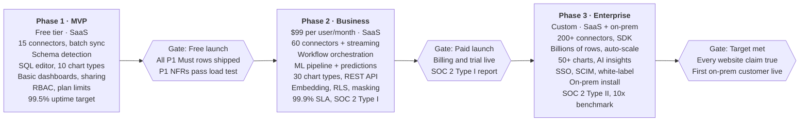

# Product Brief

As of 2026-11-12. See [README](README.md) for phase and ID conventions.

## Vision, customers and personas

Telescope is one platform to connect, process, analyze and share data from any source, from ingestion to visualization. The website targets everyone from startups to Fortune 500 companies. We reach them in order: small teams first (P1), mid-size companies paying per user (P2), then regulated enterprises that need on-prem (P3).

| Persona | Main job in Telescope | First phase served |
| --- | --- | --- |
| Data engineer | Connects sources, builds pipelines, monitors syncs | P1 |
| Data analyst | Writes SQL, builds dashboards | P1 |
| Workspace admin | Invites users, assigns roles, manages plan | P1 |
| Business viewer | Reads shared dashboards, applies filters | P1 |
| Data scientist | Trains and runs ML models on platform data | P2 |
| App developer | Pulls data and embeds charts via API | P2 |
| Security / IT admin | SSO, audit, data sovereignty, on-prem install | P3 |

Open question: which industry or customer segment do we sell to first? The website names none, and this choice drives which connectors come first.

## Phase overview

We reach the website's full promise in three phases. Each phase ends at a gate that unlocks the next pricing tier.

| Phase | Tier | Scope highlights | Exit gate |
| --- | --- | --- | --- |
| P1 · MVP | Free · SaaS | 15 connectors, batch sync, schema detection, SQL editor, 10 chart types, basic dashboards and sharing, RBAC, plan limits, 99.5% uptime target | All P1 Must rows shipped; P1 NFRs pass load test |
| P2 · Business | $99 per user/month · SaaS | 60 connectors + streaming, workflow orchestration, ML pipeline, 30 chart types, REST API, embedding, RLS and masking, 99.9% SLA, SOC 2 Type I | Billing and trial live; SOC 2 Type I report |
| P3 · Enterprise | Custom · SaaS + on-prem | 200+ connectors and SDK, billions of rows, auto-scale, 50+ charts, AI insights, SSO/SCIM, white-label, on-prem, SOC 2 Type II, 10x benchmark | Every website claim true; first on-prem customer live |

A phase exits only when all of its Must requirements ship and its NFR targets pass. Phase durations are left open until the architecture is done and the team has estimated the work.

Details: [functional requirements](02-functional-requirements.md), [non-functional requirements](03-non-functional-requirements.md), [pricing](04-pricing-and-plan-limits.md), [scope and risks](05-scope-assumptions-risks.md).
