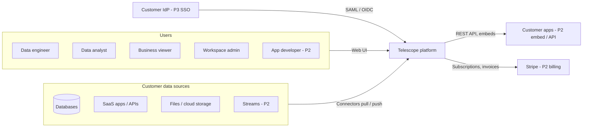
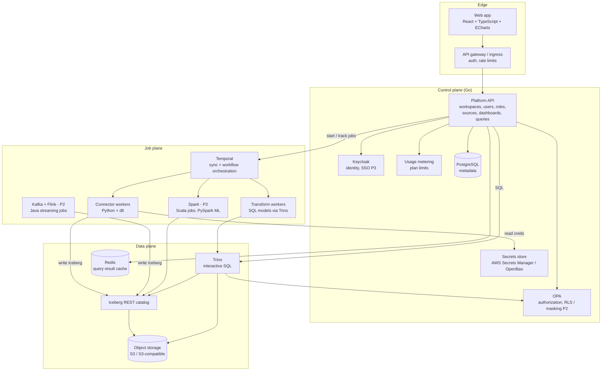
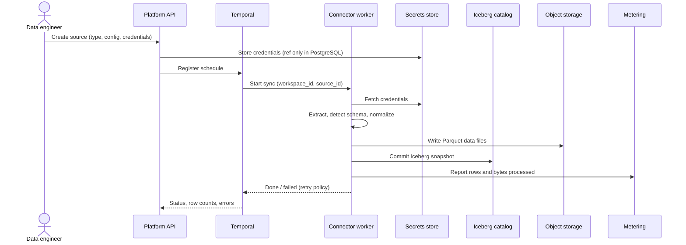

# Architecture Overview

As of 2026-11-12. Status: **Draft for review.** See [README](README.md) for phase and ID conventions. Decisions are recorded in [ADRs](adr/README.md).

Telescope is a multi-tenant lakehouse platform. Connectors land data as Apache Iceberg tables on object storage. Trino serves SQL to the editor, dashboards and API. A Go control plane manages tenants, jobs and permissions; connectors and ML run in Python, heavy Spark jobs in Scala, streaming in Java (see ADR 0011). Everything runs on Kubernetes, so the SaaS stack (AWS first) and the P3 on-prem install are the same software.

## 1. Architecture principles

| # | Principle | Why | Driven by |
| --- | --- | --- | --- |
| 1 | **One codebase for SaaS and on-prem.** No component that only exists as a managed cloud service in the core path. | P3 on-prem must not fork the product. | NFR-DEP-001, FR-PLT-008 |
| 2 | **Open table format on object storage.** Data lives in Iceberg, not inside a proprietary engine. | Swap or add engines (Trino, Spark, Flink) without migrating data; cheap storage for 1-year and custom retention. | NFR-SCL-001, NFR-DAT-001 |
| 3 | **Reuse open source, build the product layer.** Build UI, control plane, multi-tenancy, metering. Reuse engines, connectors, orchestration. | A small team can't build 200+ connectors or a query engine. | FR-INT-001, Risks |
| 4 | **Tenant isolation is designed in from P1.** Every request, table and job carries a `workspace_id`. | Retrofitting isolation is the most expensive mistake in multi-tenant systems. | NFR-SEC-003 |
| 5 | **Phase-sized complexity.** P1 runs the minimum set of services; streaming, Spark and ML arrive in P2. | Ship the Free tier sooner; keep ops load small. | Phase plan |
| 6 | **Everything is measured.** Usage events and telemetry come from day one. | Plan limits, billing and NFR targets all need data. | FR-PLT-003/004, NFR-OPS-001 |

## 2. System context

## 3. Container view

## 4. Components

| Component | Responsibility | Technology | Phase | ADR | Requirements |
| --- | --- | --- | --- | --- | --- |
| Web app | Query editor, dashboard builder, source setup, admin | TypeScript, React, Apache ECharts | P1 | [0011](adr/0011-application-stack.md) | FR-EXP-001..004, FR-SHR-001 |
| API gateway | TLS termination, routing, API keys, rate limits | Kubernetes ingress (e.g. Envoy-based) | P1 (rate limits P2) | [0002](adr/0002-kubernetes-everywhere.md) | FR-SHR-003, NFR-SEC-001 |
| Platform API | All product logic and metadata CRUD; the only writer to PostgreSQL | Go (OpenAPI-generated stubs) | P1 | [0011](adr/0011-application-stack.md) | FR-PLT-*, FR-SHR-* |
| Identity | Users, login, sessions, SSO, SCIM | Keycloak | P1 (SSO P3) | [0009](adr/0009-identity-keycloak.md) | FR-PLT-001/006 |
| Authorization | RBAC decisions; row filters and column masks for Trino | Open Policy Agent (OPA) | P1 RBAC, P2 RLS | [0009](adr/0009-identity-keycloak.md) | FR-PLT-002, FR-SHR-006 |
| Metadata store | Workspaces, users, sources, jobs, dashboards, usage | PostgreSQL | P1 | [0007](adr/0007-postgresql-metadata-store.md) | — |
| Secrets store | Connector credentials, encryption keys | AWS Secrets Manager (SaaS), OpenBao (on-prem) | P1 | [0010](adr/0010-secrets-management.md) | NFR-SEC-002 |
| Orchestrator | Schedules, retries, DAGs of sync and transform steps | Temporal (workflows in Go, activities in Python / Scala / Java) | P1 | [0006](adr/0006-orchestration-temporal.md) | FR-INT-002, FR-PRC-002 |
| Connector workers | Extract from sources, schema detection, incremental state, load to Iceberg | Python + dlt | P1 | [0005](adr/0005-connector-framework-dlt.md) | FR-INT-001..005, 007, 009 |
| Table storage | Tables, schema evolution, snapshots, retention | Apache Iceberg on S3 / S3-compatible | P1 | [0003](adr/0003-lakehouse-iceberg.md) | FR-INT-004, NFR-DAT-001 |
| Catalog | Iceberg table metadata, per-workspace namespaces | Iceberg REST catalog (Polaris or Lakekeeper, spike in P1) | P1 | [0003](adr/0003-lakehouse-iceberg.md) | FR-EXP-007 |
| Query engine | Interactive SQL for editor, dashboards, API | Trino | P1 | [0004](adr/0004-query-engine-trino.md) | FR-EXP-001, NFR-PRF-001 |
| Result cache | Cached dashboard query results | Redis | P1 | [0004](adr/0004-query-engine-trino.md) | NFR-PRF-003 |
| Usage metering | Count sources, processing GB, storage; enforce plan limits | Platform API + PostgreSQL usage tables | P1 | [0014](adr/0014-usage-metering.md) | FR-PLT-003/004 |
| Streaming | Real-time ingest from Kafka, Kinesis, webhooks | Apache Kafka + Apache Flink (Java jobs) | P2 | [0012](adr/0012-streaming-kafka-flink.md) | FR-INT-006, NFR-SCL-002 |
| Distributed compute + ML | Large batch jobs (Scala), ML training and scoring (PySpark, MLlib) | Apache Spark on Kubernetes | P2 | [0013](adr/0013-distributed-compute-ml-spark.md) | FR-PRC-003/005 |
| Billing | Subscriptions, trials, invoices | Stripe | P2 | [0014](adr/0014-usage-metering.md) | FR-PLT-005 |
| Observability | Logs, metrics, traces, alerts | OpenTelemetry, Prometheus, Grafana, Loki | P1 | [0015](adr/0015-observability.md) | NFR-OPS-001 |

## 5. Key flows

### 5.1 Batch sync (P1)

### 5.2 Interactive query and dashboard (P1)

1. The web app sends SQL (editor) or a chart query (dashboard) to the Platform API.
2. The API checks the user's role and plan limits, then opens a Trino session with the user identity and `workspace_id`.
3. Trino asks OPA whether the user may read each table. In P2, OPA also returns row filters and column masks.
4. Trino reads only the workspace's Iceberg namespace. Results stream back.
5. Dashboard results are cached in Redis, keyed by query hash + workspace + data snapshot ID, so a new sync invalidates them.

### 5.3 Streaming ingest (P2)

Source → Kafka topic per workspace source → Flink job → Iceberg table commits every ≤ 60 s (NFR-SCL-002, P2). The P3 target of < 5 s needs a hot serving layer beside Iceberg; that decision is open in [ADR 0012](adr/0012-streaming-kafka-flink.md).

## 6. Multi-tenancy and data isolation

See [ADR 0008](adr/0008-multi-tenancy-model.md).

| Layer | P1 (Free) | P2 (Business) | P3 (Enterprise) |
| --- | --- | --- | --- |
| Metadata | Shared PostgreSQL, `workspace_id` on every row, enforced by row-level security in PostgreSQL | Same | Dedicated instance (on-prem) |
| Storage | Shared bucket, one prefix per workspace; one Iceberg namespace per workspace | + per-workspace encryption key | Customer's own storage |
| Query compute | Shared Trino cluster, one resource group per workspace (CPU, memory, concurrency caps) | + optional dedicated Trino cluster | Dedicated cluster |
| Job compute | Shared worker pools, per-workspace concurrency limits | + dedicated pools option | Dedicated |
| Credentials | Separate secret per source, path scoped by workspace | Same + rotation | Customer vault |

Isolation tests (cross-tenant read attempts at API, Trino and storage level) run in CI from P1.

## 7. Deployment

| | SaaS (P1–P3) | On-prem (P3) |
| --- | --- | --- |
| Cluster | AWS EKS, one region in P1, multi-region in P2 | Customer Kubernetes |
| Packaging | Helm charts, GitOps (Argo CD) | Same Helm charts + installer, offline image bundle |
| Object storage | Amazon S3 | Customer S3-compatible storage (e.g. Ceph RGW; MinIO needs AGPL review) |
| PostgreSQL | Amazon RDS for PostgreSQL | Bundled PostgreSQL operator (e.g. CloudNativePG) or customer DB |
| Secrets | AWS Secrets Manager + KMS | OpenBao |
| Infra as code | OpenTofu | — |
| Billing, telemetry to us | Yes | Off by default; license key instead |

Environments: `dev` → `staging` → `prod`. Staging carries a synthetic tenant set used for load tests (NFR-PRF, NFR-SCL).

## 8. How the NFRs are met

| NFR | Design response |
| --- | --- |
| NFR-AVL-001 99.5% → 99.9% | P1: multi-AZ EKS and RDS, stateless API with ≥ 2 replicas. P2: Trino coordinator failover, Temporal HA, status page, error budgets. |
| NFR-AVL-002 RPO / RTO | RDS point-in-time recovery; S3 versioning; Iceberg snapshots allow table rollback. P2: cross-region backup copies. |
| NFR-PRF-001/003 query latency | Trino on Iceberg with partitioning and file compaction jobs; Redis result cache; per-workspace resource groups to stop noisy neighbors. |
| NFR-PRF-002 "10x faster" | Benchmark harness in staging from P1; baseline is an open question. |
| NFR-SCL-001 volume | P1: Trino + connector workers handle 10M-row jobs. P2: Spark on Kubernetes for 1B-row jobs. |
| NFR-SCL-004 auto-scaling | P2: Kubernetes autoscaling for API and workers; Trino worker autoscaling on queue depth. |
| NFR-SEC-001 encryption | TLS everywhere (ingress + service mesh mTLS in P2); S3 SSE-KMS; P2 per-workspace keys; P3 BYOK. |
| NFR-SEC-002 credentials | Credentials never in PostgreSQL or logs; workers fetch at runtime with short-lived tokens. |
| NFR-CMP-001 SOC 2 | Audit-ready from P1: infra as code, access reviews, centralized logs, change history in Git. |
| NFR-CMP-002 GDPR | Workspace deletion job removes metadata, Iceberg tables and secrets; P2 EU region. |
| NFR-DAT-001 retention | Scheduled Iceberg snapshot expiry and table deletion per plan. |

## 9. Evolution by phase

| Phase | Added to the architecture |
| --- | --- |
| P1 | Web app, Platform API, Keycloak, OPA (RBAC), PostgreSQL, Temporal, connector workers (dlt), Iceberg + REST catalog, Trino, Redis, metering, observability. Single AWS region. |
| P2 | Kafka + Flink, Spark + MLlib, OPA row filters / column masks, public REST API + API keys, embedding service, Stripe billing, audit log, autoscaling, second region, SOC 2 Type I. |
| P3 | On-prem packaging and installer, SSO / SCIM, BYOK, connector SDK for customers, real-time serving layer (< 5 s), AI insights service, white-label theming, SOC 2 Type II. |

## 10. Open items

- [ ] Spike: Iceberg REST catalog choice (Apache Polaris vs. Lakekeeper) — P1, week 1–2.
- [ ] Spike: dlt coverage of the P1 top 15 connectors; list gaps that need custom code.
- [ ] Load test: Trino on shared cluster with 500 workspaces (NFR-SCL-003, P1).
- [ ] Legal: license review of every bundled open-source component before on-prem distribution.
- [ ] Decide the real-time serving layer for P3 (< 5 s), during P2.
- [ ] Decide the LLM approach for AI insights (FR-EXP-006), during P2.
