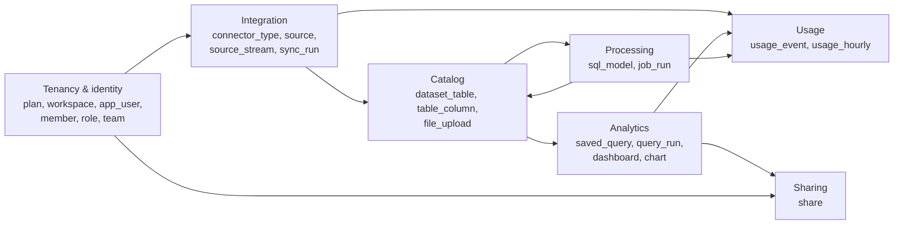
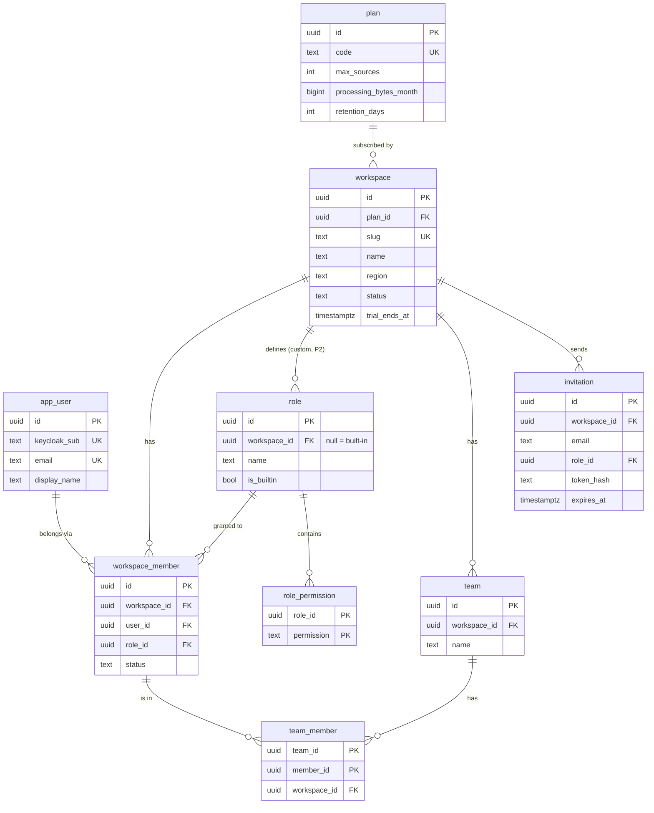
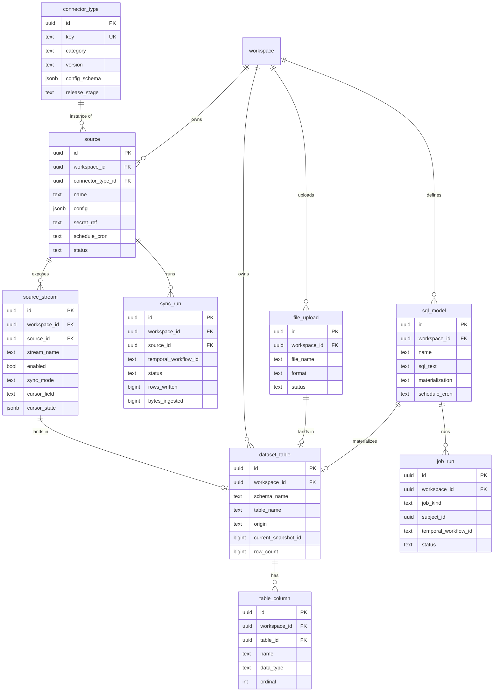
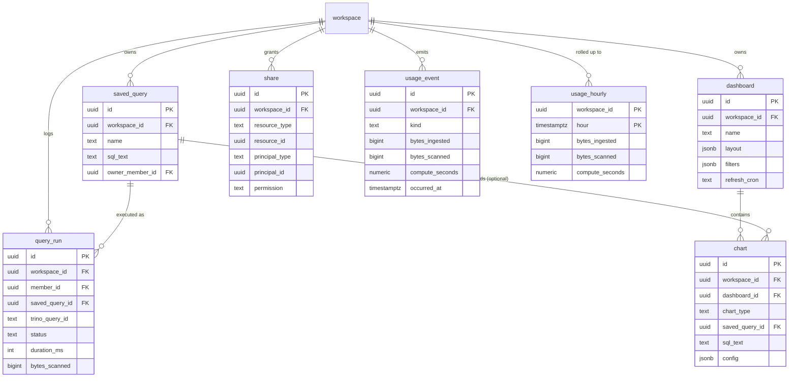

# Data Model / ERD

As of 2026-11-12. Status: **Draft — built on assumptions** (see §1). See [README](README.md) for ID conventions, [architecture](06-architecture.md) and [ADRs](adr/README.md) for context.

This doc defines two models:

1. **Metadata model** — the PostgreSQL schema owned by the Go Platform API ([ADR 0007](adr/0007-postgresql-metadata-store.md), [ADR 0011](adr/0011-application-stack.md)). Sections 2–6.
2. **Data layout** — how customer data is organized in Iceberg and Trino ([ADR 0003](adr/0003-lakehouse-iceberg.md), [ADR 0004](adr/0004-query-engine-trino.md)). Section 7.

## 1. Assumptions (open questions not yet answered)

| # | Assumption used here | Open question it stands in for | Impact if it changes |
| --- | --- | --- | --- |
| A1 | Usage records **all three** measures: bytes ingested, bytes scanned, compute seconds. The billing metric picks one later. | What "processing GB" measures ([pricing](04-pricing-and-plan-limits.md#open-questions)) | None on schema; only rollup logic. |
| A2 | Connectors are rows in a generic `connector_type` catalog; no table per connector. | Top 15 P1 connectors | None. |
| A3 | "Retention" = how long ingested data and query history are kept; older data is deleted. Iceberg snapshots are expired separately (shorter). | Retention meaning per plan | Retention job logic only. |
| A4 | Business limit of 100 GB is **per workspace**. | Per workspace or per user | `plan` columns. |
| A5 | One SaaS region in P1; `workspace.region` exists so P2 multi-region needs no migration. | Cloud region | None. |
| A6 | A user can belong to several workspaces with one login. | — (product choice) | `app_user` would become workspace-scoped. |
| A7 | Users see SQL names like `raw_postgres.orders`; the physical Iceberg name includes the workspace (§7). | Trino isolation approach (Trino spike) | §7 only. |

## 2. Conventions

| Rule | Detail |
| --- | --- |
| Primary keys | `id uuid` (UUIDv7, time-ordered), generated by the API. |
| Tenant key | Every tenant-owned table has `workspace_id uuid NOT NULL`. |
| Tenant enforcement | PostgreSQL row-level security on every tenant table: `USING (workspace_id = current_setting('app.workspace_id')::uuid)`. The API sets `app.workspace_id` per transaction. |
| Cross-tenant FK safety | Tenant tables have `UNIQUE (workspace_id, id)`; child FKs reference `(workspace_id, parent_id)`, so a row can never point at another workspace's row. |
| Global tables | Only `plan`, `connector_type`, `app_user` have no `workspace_id`. (`user` is reserved in PostgreSQL.) |
| Timestamps | `created_at`, `updated_at` as `timestamptz` (UTC) on every table. |
| Deletes | Soft delete (`deleted_at`) for user-facing objects; a GDPR purge job hard-deletes after the grace period (NFR-CMP-002). |
| Enums | PostgreSQL `text` + `CHECK` constraint (easier to extend than native enums). |
| Flexible config | `jsonb` only for connector config, chart config and layouts; everything queried or joined is a real column. |
| Not stored here | Credentials (only `secret_ref`, [ADR 0010](adr/0010-secrets-management.md)); customer data (Iceberg); passwords (Keycloak); workflow history (Temporal's own DB). |
| Naming | `snake_case`, singular table names. |
| Migrations | Owned by the Go API (Atlas or golang-migrate). No other service writes these tables. |

## 3. Overview — domains

## 4. P1 entity-relationship diagrams

### 4.1 Tenancy and identity

### 4.2 Integration, catalog and processing

### 4.3 Analytics, sharing and usage

## 5. P1 tables — columns and rules

Common columns (`id`, `workspace_id`, `created_at`, `updated_at`, `deleted_at`) are omitted below unless they matter.

### 5.1 Tenancy and identity

| Table | Key columns | Constraints and notes | Requirements |
| --- | --- | --- | --- |
| `plan` | `code` (`free`, `business`, `enterprise`), `max_sources` (null = unlimited), `processing_bytes_month`, `retention_days`, `max_members`, `features jsonb` (flags: `streaming`, `ml`, `api`, `rls`, `sso`) | Seeded by migration. Free: 5 sources, 1 GB, 7 days. Business: unlimited, 100 GB, 365 days. | FR-PLT-003, NFR-DAT-001 |
| `workspace` | `plan_id`, `slug` (unique, URL-safe), `name`, `region`, `status` (`active`, `suspended`, `deleting`), `trial_ends_at`, `owner_user_id` | The tenant. Deleting sets `status = deleting` and starts the purge workflow. | FR-PLT-001 |
| `app_user` | `keycloak_sub` (unique), `email` (unique, citext), `display_name`, `last_login_at` | Global. Mirror of Keycloak identity; no passwords. | FR-PLT-001 |
| `workspace_member` | `user_id`, `role_id`, `status` (`active`, `disabled`) | `UNIQUE (workspace_id, user_id)`. At least one active Admin per workspace (API check). | FR-PLT-002 |
| `role` | `name`, `is_builtin`, `workspace_id` (null for built-ins) | P1 built-ins: `admin`, `editor`, `viewer`. P2 custom roles have `workspace_id`. | FR-PLT-002 |
| `role_permission` | `role_id`, `permission` (e.g. `source.write`, `dashboard.read`) | PK `(role_id, permission)`. Pushed to OPA as data ([ADR 0009](adr/0009-identity-keycloak.md)). | FR-PLT-002 |
| `team` | `name` | `UNIQUE (workspace_id, name)`. | FR-SHR-001 |
| `team_member` | `team_id`, `member_id` | PK `(team_id, member_id)`. | FR-SHR-001 |
| `invitation` | `email`, `role_id`, `token_hash`, `invited_by`, `expires_at`, `accepted_at` | Token stored hashed. Expires after 7 days (proposal). | FR-PLT-001 |

### 5.2 Integration

| Table | Key columns | Constraints and notes | Requirements |
| --- | --- | --- | --- |
| `connector_type` | `key` (e.g. `postgres`, `salesforce`), `display_name`, `category` (`database`, `saas`, `file`, `storage`, `stream`), `version`, `config_schema jsonb` (JSON Schema for the setup form), `release_stage` (`alpha`, `beta`, `ga`), `min_plan_code` | Global catalog. Workers register their connector types on deploy. | FR-INT-001 |
| `source` | `connector_type_id`, `name`, `config jsonb` (non-secret settings), `secret_ref` (path in secrets store), `schedule_cron`, `status` (`active`, `paused`, `error`), `last_sync_at` | Free plan: count of non-deleted sources ≤ `plan.max_sources` (API check). `config` must never contain secrets (validated against `config_schema` `x-secret` fields). | FR-INT-001/002, NFR-SEC-002 |
| `source_stream` | `source_id`, `stream_name` (table/object at source), `enabled`, `sync_mode` (`full`, `incremental`, P2 `cdc`), `cursor_field`, `primary_key text[]`, `cursor_state jsonb`, `dataset_table_id` | `UNIQUE (source_id, stream_name)`. `cursor_state` is written only via the API when a sync succeeds. | FR-INT-004/005 |
| `sync_run` | `source_id`, `trigger` (`schedule`, `manual`), `temporal_workflow_id`, `temporal_run_id`, `status` (`queued`, `running`, `succeeded`, `failed`, `cancelled`), `started_at`, `finished_at`, `rows_read`, `rows_written`, `bytes_ingested`, `error_code`, `error_message` | Index `(workspace_id, source_id, started_at DESC)`. Retained per plan (A3). | FR-INT-009 |

### 5.3 Catalog and processing

| Table | Key columns | Constraints and notes | Requirements |
| --- | --- | --- | --- |
| `dataset_table` | `schema_name` (user-visible, e.g. `raw_postgres`), `table_name`, `iceberg_identifier` (physical, §7), `origin` (`source`, `model`, `upload`, P2 `ml`, P2 `stream`), `origin_id`, `current_snapshot_id`, `row_count`, `size_bytes`, `description`, `schema_version` | `UNIQUE (workspace_id, schema_name, table_name)`. A mirror of the Iceberg catalog for search and UI; Iceberg is the source of truth for schema. Refreshed after each sync/model run. | FR-EXP-007, FR-INT-004 |
| `table_column` | `table_id`, `name`, `data_type`, `ordinal`, `nullable`, `description` | `UNIQUE (table_id, name)`. P2 adds masking via `column_mask`. | FR-EXP-007 |
| `file_upload` | `file_name`, `format` (`csv`, `json`, `parquet`, `xlsx`), `size_bytes`, `staging_uri`, `status` (`uploaded`, `parsing`, `loaded`, `failed`), `dataset_table_id` | Staging file deleted after load. | FR-INT-003 |
| `sql_model` | `name`, `sql_text`, `materialization` (`table`, `view`), `target_table_id`, `schedule_cron`, `depends_on uuid[]` | `UNIQUE (workspace_id, name)`. Runs on Trino ([ADR 0004](adr/0004-query-engine-trino.md)). | FR-PRC-001 |
| `job_run` | `job_kind` (`model`, `maintenance`, `retention`, `purge`, P2 `workflow`, P2 `ml_train`, P2 `ml_score`), `subject_id`, `temporal_workflow_id`, `status`, `started_at`, `finished_at`, `error_message`, `stats jsonb` | Generic run log for everything that is not a sync. | FR-PRC-001, FR-INT-009 |

### 5.4 Analytics and sharing

| Table | Key columns | Constraints and notes | Requirements |
| --- | --- | --- | --- |
| `saved_query` | `name`, `sql_text`, `owner_member_id`, `folder` | | FR-EXP-001 |
| `query_run` | `member_id`, `saved_query_id` (nullable), `sql_text`, `sql_hash`, `trino_query_id`, `status`, `started_at`, `duration_ms`, `rows_returned`, `bytes_scanned`, `cache_hit`, `error_message` | **High volume**: range-partitioned by month on `started_at`; old partitions dropped per plan retention. Feeds query history and NFR-PRF-001 measurement. | FR-EXP-001, NFR-PRF-001 |
| `dashboard` | `name`, `layout jsonb` (grid positions), `filters jsonb`, `refresh_cron`, `owner_member_id` | | FR-EXP-002/004 |
| `chart` | `dashboard_id`, `chart_type` (one of the supported types: 10 in P1), `saved_query_id` **or** `sql_text`, `config jsonb` (ECharts options built from field mapping) | `CHECK (saved_query_id IS NOT NULL OR sql_text IS NOT NULL)`. | FR-EXP-002/003 |
| `share` | `resource_type` (`dashboard`, `saved_query`), `resource_id`, `principal_type` (`member`, `team`, P2 `public_link`), `principal_id`, `permission` (`view`, `edit`), `granted_by` | `UNIQUE (resource_type, resource_id, principal_type, principal_id)`. Polymorphic: the API validates that `resource_id` exists in the same workspace. | FR-SHR-001 |

### 5.5 Usage and limits

| Table | Key columns | Constraints and notes | Requirements |
| --- | --- | --- | --- |
| `usage_event` | `kind` (`sync`, `query`, `model`, `upload`, P2 `stream`, P2 `ml`), `ref_id`, `bytes_ingested`, `bytes_scanned`, `compute_seconds`, `occurred_at`, `idempotency_key` | Append-only, partitioned by day; `UNIQUE (idempotency_key)` so retries don't double count. Raw rows kept 35 days. | FR-PLT-003, [ADR 0014](adr/0014-usage-metering.md) |
| `usage_hourly` | `workspace_id`, `hour`, `bytes_ingested`, `bytes_scanned`, `compute_seconds`, `query_count`, `sync_count` | PK `(workspace_id, hour)`. Rolled up by a Temporal job. Monthly limit checks read this table plus the current hour. | FR-PLT-003/004 |
| `usage_storage_daily` | `workspace_id`, `day`, `storage_bytes`, `table_count` | Snapshot from Iceberg metadata, for the usage dashboard. | FR-PLT-004 |

## 6. P2 and P3 additions

All follow the same conventions (tenant key, RLS, composite FKs).

| Table | Phase | Purpose | Key columns | Requirements |
| --- | --- | --- | --- | --- |
| `api_key` | P2 | Programmatic access | `name`, `key_prefix`, `key_hash`, `role_id`, `created_by`, `last_used_at`, `expires_at`, `revoked_at` | FR-SHR-003 |
| `audit_log` | P2 | Who did what | `actor_type` (`member`, `api_key`, `system`), `actor_id`, `action`, `resource_type`, `resource_id`, `ip`, `metadata jsonb`, `occurred_at` | FR-PLT-007 |
| `subscription` | P2 | Billing state mirrored from Stripe | `stripe_customer_id`, `stripe_subscription_id`, `status`, `seats`, `current_period_end` | FR-PLT-005 |
| `workflow` | P2 | Visual DAG definitions | `name`, `definition jsonb` (nodes, edges), `schedule_cron`, `enabled`, `version` | FR-PRC-002 |
| `row_policy` | P2 | Row-level security | `table_id`, `role_id` or `team_id`, `filter_sql` | FR-SHR-006 |
| `column_mask` | P2 | Column masking | `column_id`, `role_id` or `team_id`, `mask_type` (`null`, `hash`, `partial`) | FR-SHR-006 |
| `public_link` | P2 | Public / embed access | `resource_type`, `resource_id`, `token_hash`, `allowed_origins text[]`, `expires_at` | FR-SHR-004/005 |
| `ml_model` / `ml_model_version` | P2 | Trained models | `name`, `task` (`classification`, `regression`, `clustering`), `training_table_id`, `target_column`; version: `metrics jsonb`, `artifact_uri`, `status` | FR-PRC-005/006 |
| `stream_source` columns | P2 | Streaming config on `source` | `kafka_topic`, `commit_interval_s` | FR-INT-006 |
| `workspace_key` | P2 | Per-workspace encryption key reference | `kms_key_ref`, `rotated_at` | NFR-SEC-001 |
| `sso_connection` | P3 | SAML / OIDC | `protocol`, `keycloak_idp_alias`, `email_domains text[]`, `scim_enabled` | FR-PLT-006 |
| `branding` | P3 | White-label | `logo_uri`, `colors jsonb`, `custom_domain` | FR-SHR-007 |

## 7. Data layout in Iceberg and Trino

### 7.1 Storage and naming

| Level | P1 layout | Example |
| --- | --- | --- |
| Bucket | One per region | `s3://telescope-<region>-lake/` |
| Workspace prefix | One per workspace, scoped credentials | `s3://telescope-<region>-lake/w_<workspace_id>/` |
| Iceberg namespace (physical) | `w_<workspace_short_id>__<schema_name>` | `w_01hx3k9a__raw_postgres` |
| User-visible schema | `<schema_name>` | `raw_postgres` |
| Table | Source stream / model / upload name, normalized to snake_case | `orders` |

User-visible schemas by origin:

| Origin | Schema name | Example |
| --- | --- | --- |
| Connector sync | `raw_<source_name>` | `raw_postgres.orders` |
| File upload | `uploads` | `uploads.q3_targets` |
| SQL model | `models` (or a user-chosen schema) | `models.daily_revenue` |
| ML output (P2) | `ml` | `ml.churn_scores` |
| Platform views | `telescope` | `telescope.sync_runs` (read-only views of the user's own metadata) |

**Mapping user names to physical names** (A7) is decided by the Trino spike. Two candidates:

| Option | How | Trade-off |
| --- | --- | --- |
| a. Catalog per workspace | Trino dynamic catalog `w_<id>` pointing at the workspace's namespaces; the API sets the session catalog | Clean SQL and strong isolation; dynamic catalogs at 5,000 workspaces need testing |
| b. Shared catalog + prefix | One `lake` catalog; OPA allows only `w_<id>__*` schemas; the API sets a session default and maps names | Simple; users may see physical names in errors and `SHOW SCHEMAS` needs filtering |

### 7.2 Columns added to every ingested table

| Column | Type | Purpose |
| --- | --- | --- |
| `_telescope_synced_at` | timestamp | When this row was loaded |
| `_telescope_sync_run_id` | uuid | Links the row to `sync_run` for debugging |
| `_telescope_deleted` | boolean | Soft-delete flag for incremental / CDC sources (P2) |

### 7.3 Partitioning and maintenance defaults

- Default partition: `day(_telescope_synced_at)` for append-only streams; none for small tables (< 1 GB).
- Compaction, snapshot expiry (keep 7 days of snapshots) and orphan-file cleanup run as `job_run` (`maintenance`) per workspace — Scala Spark jobs from P2, Trino `ALTER TABLE ... EXECUTE` in P1.
- Retention (A3): a `retention` job deletes rows older than `plan.retention_days` by `_telescope_synced_at`, then expires snapshots.

## 8. Lifecycle rules

| Event | What happens |
| --- | --- |
| Source deleted | `source` soft-deleted; schedule removed from Temporal; secret deleted; tables kept until the user deletes them (P1 default, to confirm). |
| Plan downgrade | Over-limit sources paused (newest first); data beyond the new retention removed at the next retention run. |
| Workspace deleted | `status = deleting` → purge workflow: Trino/Iceberg tables, S3 prefix, secrets, Temporal schedules, then PostgreSQL rows. Grace period 30 days (proposal). |
| Member removed | `workspace_member.status = disabled`; their shares stay; ownership of their dashboards moves to an Admin. |

## 9. Open items

- [ ] Confirm assumptions A1–A7 with product.
- [ ] Trino spike decides §7.1 option a or b.
- [ ] Decide whether deleting a source also deletes its tables.
- [ ] Confirm grace periods (invitation 7 days, workspace purge 30 days).
- [ ] Generate the first migration and RLS policy tests from this doc.
